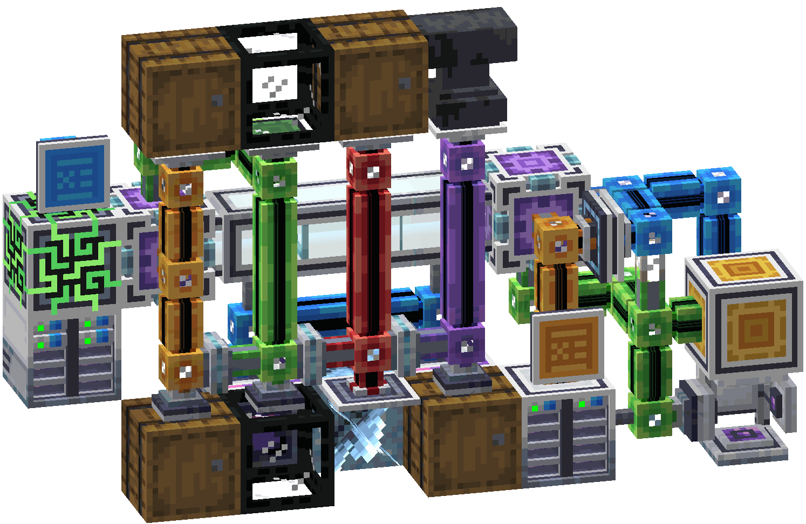

---
navigation:
  title: AE2 联邦组网
  icon: ae2federation:router
  position: 900
---

# AE2 联邦组网（AE2 Federation）

AE2 联邦组网把彼此独立的ME网络连接起来。 每个网络保留自己的频道、控制器和合成CPU， 只把你打开的内容共享给其他网络： 存储、样板供应器、机器或ME能量， 每一项都只在一个方向上生效。

* [入门](getting-started.md)： 合成零件， 连接两个网络， 并在它们之间共享存储。
* [联邦的工作方式](mechanics/index.md)： 联邦域、规则、能量、容量和联邦界面。
* [跨网络合成](crafting/index.md)： 向另一个网络的样板供应器下单， 或把处理样板发给它的机器。
* [物品与方块](items/index.md)： 每个方块的各个面、数值和配方。
* [使用示例](examples/index.md)： 完整的搭建， 从共享仓库到下界前哨。
* [排错](troubleshooting.md)： 联邦界面里各条提示的含义。
