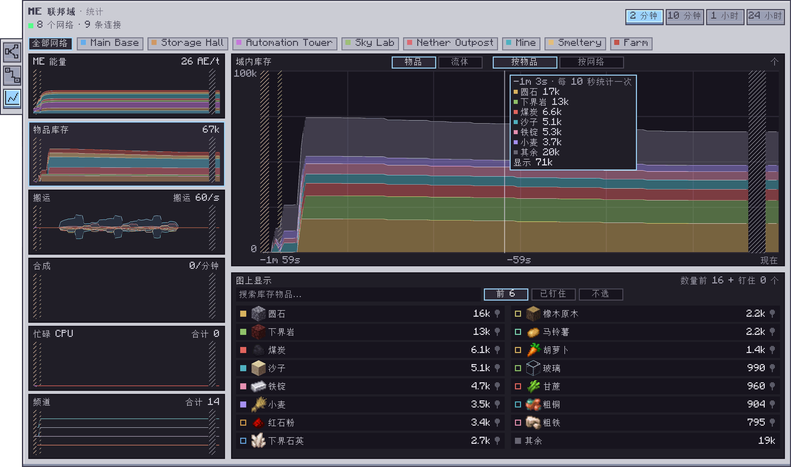

---
navigation:
  parent: index.md
  title: 统计
  icon: ae2federation:switch
  position: 270
---

# 统计

联邦界面左侧的第三个标签页是**统计**， 它用图表记录联邦域里各个网络一段时间内的情况： ME能量、联邦域的FE、存储的东西、网络之间搬运的东西、合成和频道。 它只显示这个联邦域里的网络。

## 怎么看

* **时间范围**： 右上角可以选2 分钟、10 分钟、1 小时或24 小时。 记录随世界保存， 重启后最近24小时的记录仍在。
* **网络**： 标题下面一排可以显示全部网络， 或只显示其中一个。 网络的颜色和拓扑图里一样。
* **卡片**： 左侧每张卡片显示一项指标的最新数值和一张小图。 点击卡片就在右侧画出大图， 大图下方的框里是这项指标的其他内容。
* **鼠标悬停**在图表上， 可以看到每个网络或物品在那一刻的数值。
* **斜线阴影**表示这段时间没有记录： 服务器没有运行、单人游戏暂停了， 或者某个网络没有加载。 这些时间不会画成零。

## 各项指标

| 卡片 | 大图 | 下方的框 |
| --- | --- | --- |
| ME 能量 | 每个网络的能量消耗（AE/t） | 每个网络储存的能量， 以及共享能量池 |
| 联邦能量 | 联邦域每tick的FE消耗（按方块种类）， 以及光束转换器的充满程度 | 每台光束转换器， 以及各类方块的消耗 |
| 物品库存 | 每个网络存储的东西， 按物品或按网络 | 图上画出的物品： 搜索、选择和钉住 |
| 搬运 | 网络之间搬运的东西， 按网络或按物品 | 搬运最多的东西及其路线 |
| 合成 | 每分钟开始的合成任务 | 每个网络的任务， 以及正在合成的CPU |
| 忙碌 CPU | 每个网络忙碌的合成CPU | 每个CPU在合成什么、进度如何， 或者空闲 |
| 频道 | 每个网络使用的频道 | 每个网络当前、最高和最低的频道数 |

## 物品库存

* 每个网络自己的存储每10秒统计一次。 其他网络共享给它的东西不会重复计算。
* **前 6**是默认选项， 画出联邦域里存量最多的六种物品， 其余的合成一条灰色带。 **已钉住**只画钉住的物品， **不选**清空图表。 在列表里勾选物品就是你自己的选择。
* **搜索**可以找到网络里存放的任何物品。
* **钉住**一种物品后， 即使它不在存量最多的物品里， 也会一直记录它的历史。 它的记录从钉住时开始。 一个联邦域最多钉住16种物品， 所有打开它的人看到的都一样。
* **按网络**把每个网络里所选物品的存量叠在一起显示。

## 统计范围

* **搬运**统计存储规则搬运的东西、发送到另一个网络的样板供应器的合成材料， 以及送回来的产物。 只看一个网络时， 搬进来的画在线上方， 搬出去的画在线下方。 没有存储或合成规则时没有东西可搬， 图表会直接说明。
* 共享能量池里的**ME 能量**消耗是估算值： AE2把消耗算在提供能量的那个网络上， 所以统计页按各网络的空载耗能来分摊。 网络之间流动的能量不显示。
* **合成**在网络的CPU开始一个任务时计数。 在一个游戏刻内开始又结束的任务统计不到。
