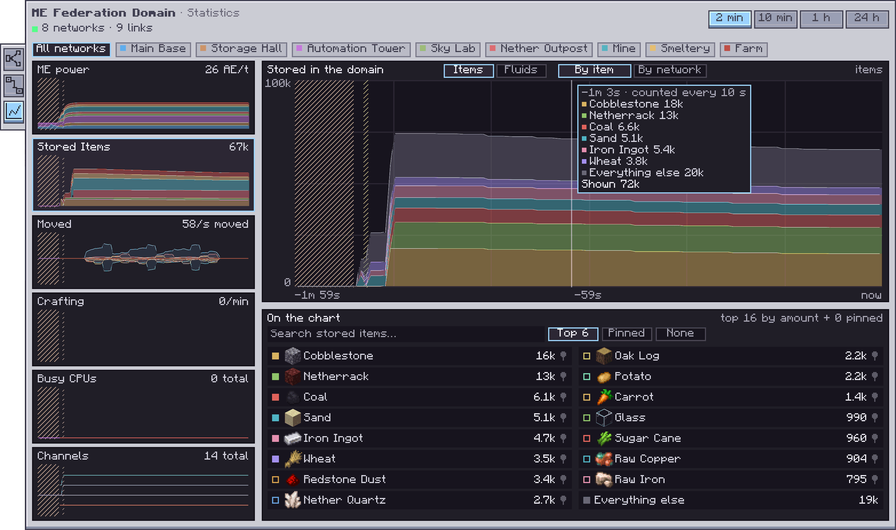

---
navigation:
  parent: index.md
  title: Statistics
  icon: ae2federation:switch
  position: 270
---

# Statistics

The **Statistics** tab, the third on the left of the Federation screen, charts what the domain's networks did over
time: their ME power, the domain's FE, what they store, what moved between them, their crafting and their channels. It shows the
networks of this domain only.

## Reading the page

* **Range.** 2 min, 10 min, 1 h or 24 h, at the top right. The history is saved with the world, so the last 24 hours
  survive a restart.
* **Networks.** The row under the title shows all networks or only one. Networks keep their colours from the graph.
* **Cards.** Each card on the left shows a metric's newest figure and a small chart. Click a card to draw it large;
  the box under the large chart shows what that metric has besides.
* **Hover** over a chart to see each network's or item's figure at that moment.
* **Hatched stretches** are time with no record: the server was not running, a singleplayer game was paused, or a
  network was not loaded. They are never drawn as zero.

## The metrics

| Card | Large chart | Box below |
| --- | --- | --- |
| ME power | Power use in AE/t, per network | Each network's stored power, and the shared pool |
| Federation power | The domain's FE use per tick, by kind of block, and how full its Beam Converters are | Each Beam Converter, and the use by block |
| Stored | What each network holds, by item or by network | The items on the chart: search, pick and pin |
| Moved | What moved between networks, by network or by item | What moved most, and its route |
| Crafting | Jobs started per minute | Each network's jobs, and the CPUs crafting now |
| Busy CPUs | Busy crafting CPUs per network | Every CPU: what it crafts and how far it is, or idle |
| Channels | Channels in use per network | Each network's channels now, at their peak and lowest |

## Stored items

* Each network's own storage is counted every 10 seconds. What another network shares with it is not counted again.
* **Top 6**, the default, draws the six items the domain holds most, and everything else as one grey band.
  **Pinned** draws only pinned items, and **None** clears the chart. Ticking items in the list picks your own.
* **Search** finds any item the networks hold.
* **Pin** keeps an item's history even when it is not among the most held. Its history starts when you pin it. A
  domain keeps up to 16 pins, the same for everyone who opens it.
* **By network** stacks each network's stock of the picked items.

## What is counted

* **Moved** counts what Storage rules carry, crafting inputs sent to another network's Pattern Provider, and the
  results coming back. With one network chosen, what came in is drawn above the line and what went out below it.
  Without a Storage or Crafting rule there is nothing to move, and the chart says so.
* **ME power** in a shared energy pool is an estimate: AE2 counts the use on the network whose cells gave the power,
  so the page splits it by each network's idle draw. Power moving between networks is not shown.
* **Crafting** counts a job when a network's CPU starts it. A job that starts and ends within one tick is missed.
