# AE2 Federation gallery

Connect independent ME networks, choose what they share, and send processing jobs to remote machines.
The gallery combines the original teaser, annotated renders of production artwork, and in-game interfaces.
All images are static WebP files; click one to open it at full size.

## Promotional overview

One long image covering shared storage, orders across networks, an outpost in another dimension and the
in-game views: **[中文版](overview-zh.webp)** · **[English](overview-en.webp)**.
Both posters are 2400 pixels wide, about 1.6 MB each. See [poster sources and reproduction](PROMO.md).

[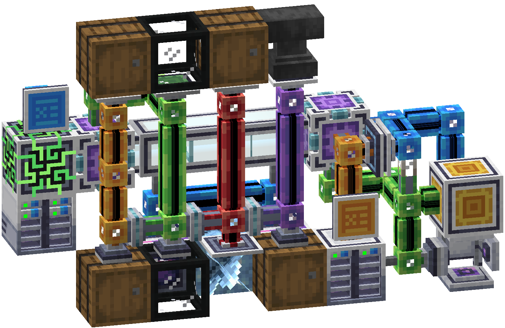](teaser.webp)

The original project teaser, preserved unchanged.

## Connect independent networks

[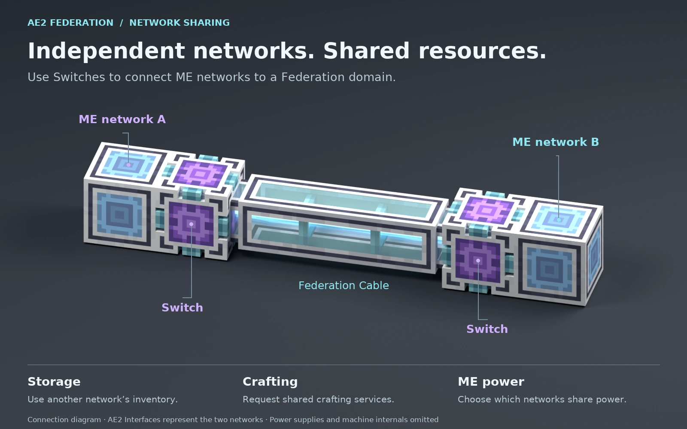](network-overview.webp)

**Keep networks independent while sharing resources.** Each Switch brings its attached ME network into the
Federation domain. The connection diagram uses an AE2 Interface to represent each network.

[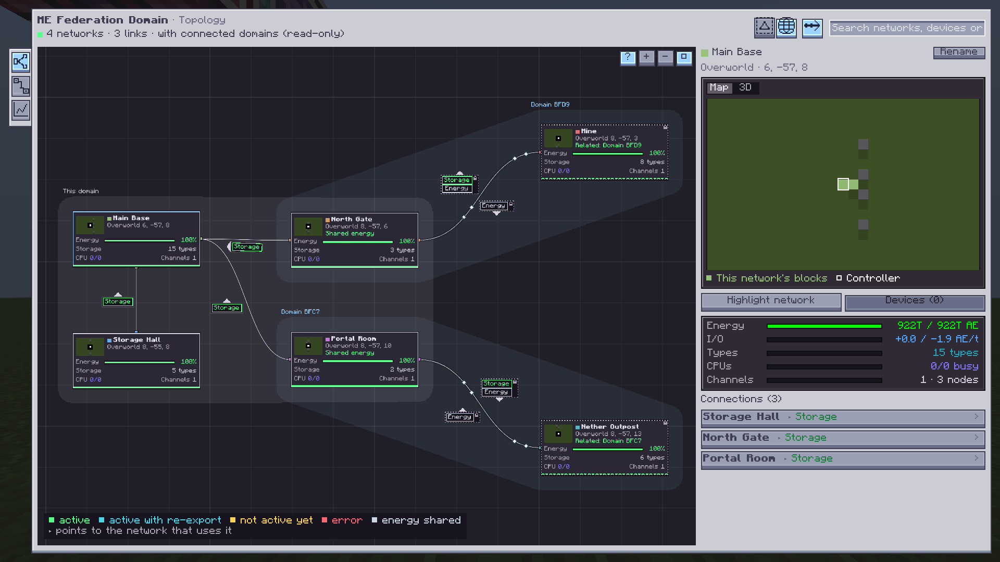](topology.webp)

**See the connections.** Network cards, directional storage links and shared ME power appear together.
The example uses creative power. All networks shown are in the Overworld, including the one named "Nether Outpost".

[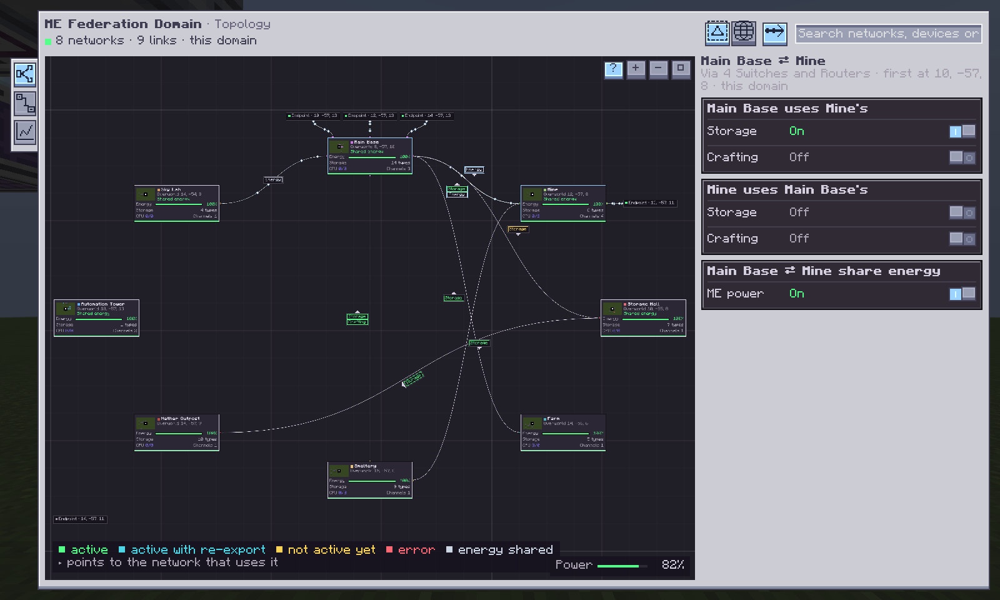](sharing-rules.webp)

**Choose what to share.** Configure Storage and Crafting in each direction, and shared ME power for the pair.

## Send processing jobs to another subnet

[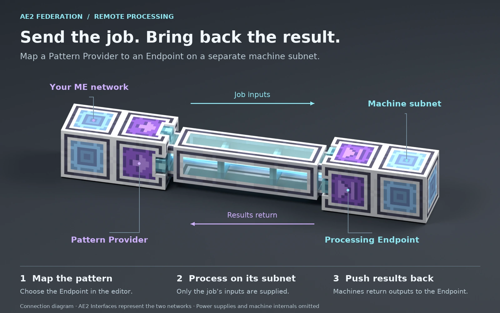](processing-installation.webp)

**Map a pattern, supply the job, receive its results.** The Pattern Provider belongs to your ME network;
the Endpoint joins the machines' separate subnet. Machines must push their outputs back into the Endpoint.
This connection diagram omits the machine internals and power supplies.

[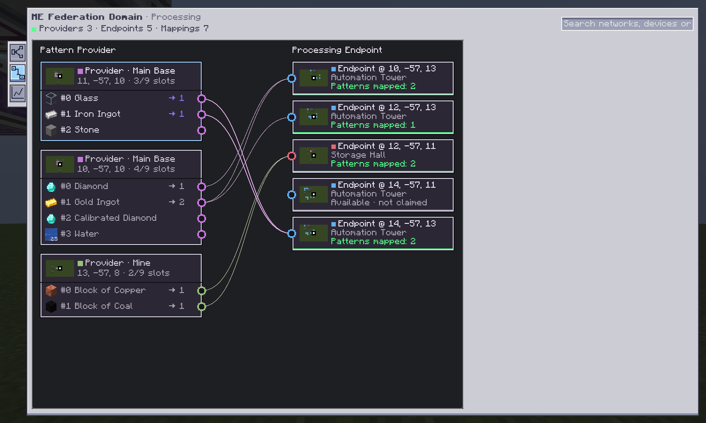](processing-mappings.webp)

**Assign the machines in the editor.** Follow a pattern's connections to its Endpoints and distinguish assigned
Endpoints from those available to claim. The sample patterns demonstrate the editor, not production recipes.

## Watch network activity

[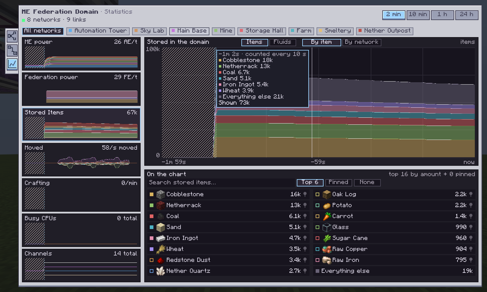](statistics-stock.webp)

**Watch stock change.** Compare stored items over time and choose which items appear in the chart.

[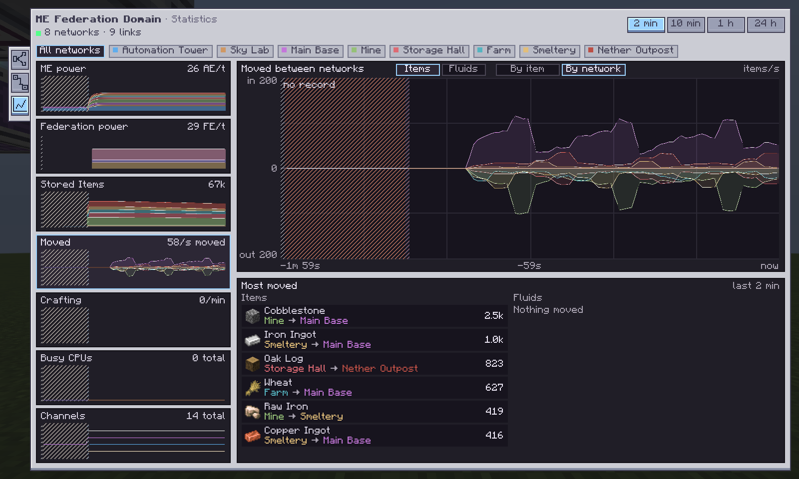](statistics-flow.webp)

**Follow transfers.** Inspect movement between networks and the items involved.
The UI screenshots use configured demonstration names, patterns and scripted activity; their figures are not
throughput benchmarks.

## Grow the infrastructure

[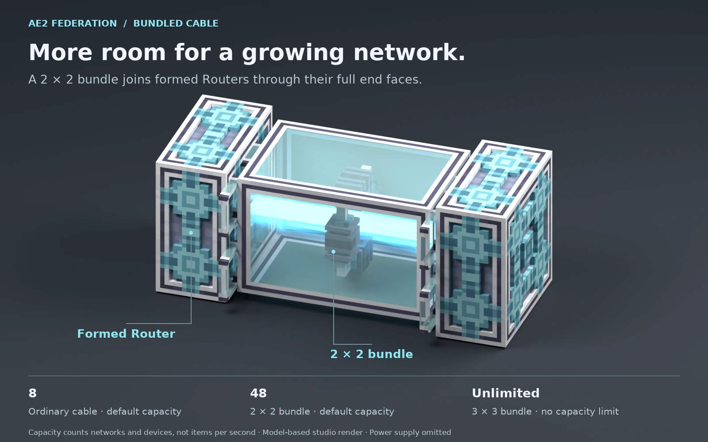](bundled-cable.webp)

**Give the domain more capacity.** Bundles connect to Router or Switch faces large enough to cover their ends.
With default settings, ordinary cable carries 8 networks and devices, a 2 × 2 bundle carries 48, and a 3 × 3 bundle
has no capacity limit. This is a count of networks and devices, not items per second.

[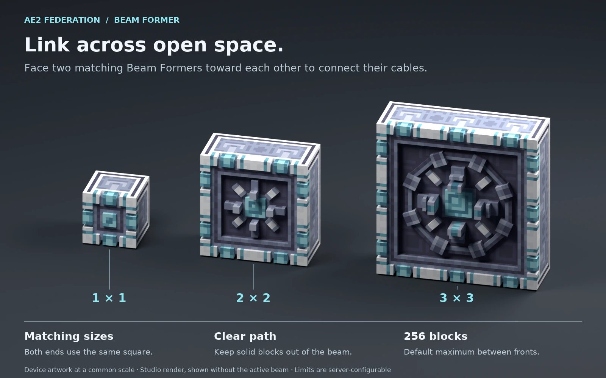](beam-sizes.webp)

**Connect across open space.** A matching pair faces one another along a clear path. The default maximum is
256 blocks between fronts. This studio comparison shows the device artwork at a common scale, without an active beam.

The four annotated images use production device models and textures, with studio lighting. Cable shells reuse
existing exporters and the cable light uses the repository's rendering adapters. They explain connections and
scale; see the guide for complete builds. Quantum Cube and Beam Converter artwork is deferred.

## Learn in game

[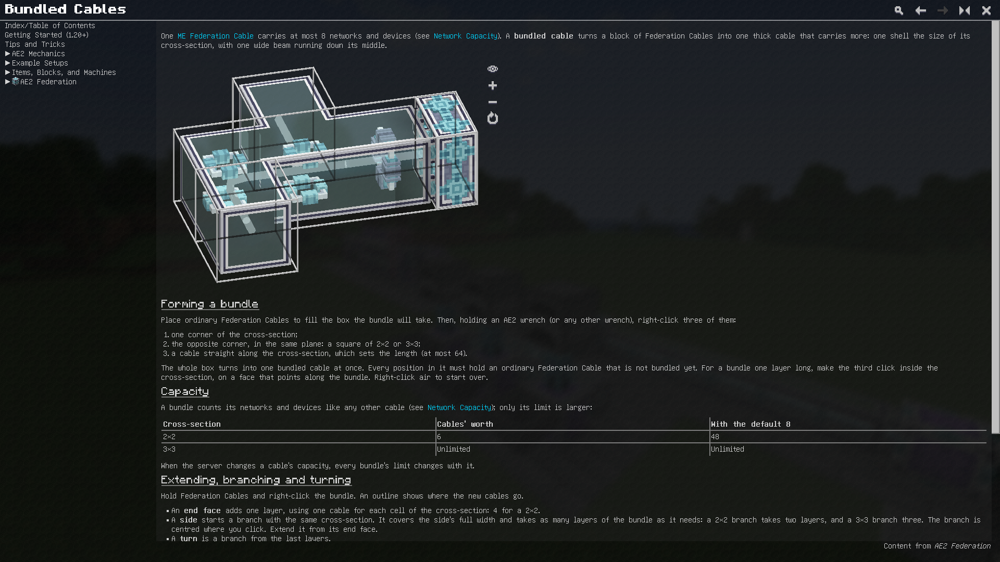](ingame-guide.webp)

**Build from illustrated instructions.** The in-game guide explains construction, connections and capacity alongside
interactive 3D scenes.

See [capture notes](CAPTURES.md) for reproduction and rendering details, and [sources.json](sources.json) for
per-image provenance, dimensions, encoding and hashes. Artwork attribution is documented in
[Third-Party Notices](../../THIRD_PARTY_NOTICES.md).
